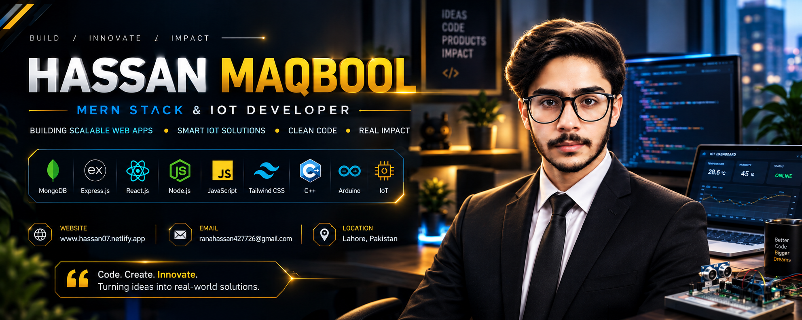

  
    
  

<h1 align="center">
  
</h1>

<h3 align="center">Full-Stack Web Developer (MERN) · AI & RAG Pipeline Engineer · IoT Systems</h3>

  
  
  

 

  <strong>Architecting low-latency full-stack applications, guarded Retrieval-Augmented Generation (RAG) pipelines, and real-time distributed systems.</strong>

## 👨‍💻 About Me

I am a **Full-Stack Software Engineer** and **AI Integration Developer** currently working at **ArhamSoft** (Chief Minister's IT Internship Program) with a **BS in Computer Science** (3.73/4.00 CGPA) from The Islamia University of Bahawalpur. I specialize in taking full-stack MERN applications and LLM-powered retrieval systems from schema design to tested, deployed production.

* 🧠 **AI & RAG Engineering:** Building multi-domain RAG pipelines with hybrid vector + keyword search (Reciprocal Rank Fusion), local cross-encoder re-ranking, Server-Sent Events (SSE) streaming, Attribute-Based Access Control (ABAC), and automated LLM-as-a-Judge evaluation suites.
* 💻 **Full-Stack Architecture:** Designing modular React & Node.js/Express systems backed by MongoDB, PostgreSQL (Supabase), and MySQL, secured with HTTP-only JWT cookies and input/moderation guardrails.
* 🧪 **Testing & API Reliability:** Enforcing backend stability with automated integration test suites (**Jest** & **Supertest**) and interactive **Swagger / OpenAPI** specifications.
* 🔌 **Embedded & IoT Systems:** 2 years of hands-on experience bridging hardware microcontrollers (Arduino, RFID, sensors) with real-time web monitoring dashboards.

## 🛠️ Tech Stack & Tooling

**Frontend Engineering** 

**Backend & Databases** 

**AI, RAG & LLM Infrastructure** 

**Testing, Docs, DevOps & IoT** 
 

## 🚀 Featured Engineering Projects

### 🧠 Production-Grade Advanced RAG Chatbot
An enterprise-ready Retrieval-Augmented Generation system built on the MERN stack with strict access control, multi-stage retrieval, and automated quality evaluation.
* **Tech Stack:** React.js, Node.js, Express.js, MongoDB Atlas Vector Search, Gemini API, OpenAI SDK, OpenRouter, `@xenova/transformers`, LangChain
* **Key Architecture:**
  * **Hybrid Retrieval & Re-Ranking:** Combines dense vector search (`all-MiniLM-L6-v2` 384-dim local embeddings) and keyword search fused via **Reciprocal Rank Fusion (RRF)**, followed by local cross-encoder re-ranking (`ms-marco-MiniLM-L-6-v2`).
  * **Security & Governance:** Enforces **Attribute-Based Access Control (ABAC)** metadata filtering across isolated knowledge bases, input moderation guardrails (`omni-moderation-latest`), and prompt-injection defenses.
  * **Real-Time & Evaluated:** Streams responses token-by-token via **SSE**, supports incremental document ingestion, and achieved **1.00 context recall** and **1.00 faithfulness** on an automated Gemini LLM-as-a-Judge test suite.

### 💬 Real-Time Messaging & WebRTC Audio Platform
A full-stack communication platform engineered for low-latency messaging and direct peer-to-peer voice calls.
* **Tech Stack:** React.js, Node.js, Express.js, MongoDB, Socket.IO, WebRTC
* **Key Architecture:** HTTP-only JWT cookie authentication with Two-Factor Authentication (2FA), real-time 1-on-1 and group chat rooms, cursor-based infinite scroll pagination, and WebRTC peer-to-peer audio calling.

### 🔌 Automated RFID Attendance & IoT Smart Systems
* **Tech Stack:** Arduino Uno, RFID, I2C LCD, C++, Node.js, Express.js, MongoDB
* **Key Architecture:** Designed the hardware-to-cloud architecture for an automated RFID attendance tracker syncing scan logs to a MERN web dashboard, alongside embedded automation systems (Smart Solar Panel Cleaner, Smart Parking, and Smart Rain Shelter).

  

